# 🚀 GitHub Profil README Kullanım ve Özelleştirme Rehberi

Hazırladığınız dosyalar GitHub profilinizi profesyonel, modern ve şık bir portfolyoya dönüştürmek için tasarlandı.

---

## 📁 Oluşturulan Dosyalar

1. **`README.md`**: Ana profil dosyanız. Ziyaretçi sayacı, sosyal medya rozetleri, hakkımda kısmı, yetenekler ve canlı GitHub istatistiklerini içerir.
2. **`header.svg`**: `RGB(255, 200, 15)` (`#FFC80F`) Amber Altın temalı, döner pusula/radar efektli, yanıp sönen cursor'lı özel animasyonlu vektör başlık.
3. **`header-blue.svg`**: Açık Mavi / Cyan (`#38BDF8` & `#00E5FF`) temalı alternatif animasyonlu başlık.

---

## 🛠️ GitHub Profiline Nasıl Eklenir? (3 Adım)

### 1. Adım: GitHub Özel Deposu (Repository) Açma
1. [GitHub](https://github.com)'a giriş yapın ve sağ üstteki **`+`** ikonuna tıklayıp **`New repository`** seçeneğini seçin.
2. **Repository name** kısmına **tam olarak GitHub kullanıcı adınızı** yazın (Örn: kullanıcı adınız `yigitalpsari` ise repo adı da `yigitalpsari` olmalıdır).
3. GitHub size *"✨ You found a secret!..."* mesajını gösterecektir.
4. Repoyu **Public** yapın ve **"Add a README file"** seçeneğini işaretleyip **Create repository** deyin.

### 2. Adım: Dosyaları Yükleme
Bu klasördeki şu dosyaları o depoya yükleyin (Web arayüzünden *Add file > Upload files* yapabilir veya Git ile push edebilirsiniz):
- `README.md`
- `header.svg`
- `header-blue.svg`

### 3. Adım: Kişisel Bilgileri Güncelleme (`README.md`)
`README.md` içindeki şu yer tutucuları kendi bilgilerinizle değiştirin:
- `yigitalpsari` -> Eğer GitHub kullanıcı adınız farklıysa kendi kullanıcı adınızı yazın (Ziyaretçi sayacı ve istatistik kartlarının doğru çalışması için bu gereklidir).
- `YOUR-LINKEDIN-HANDLE` -> LinkedIn profil kullanıcı adınız (Örn: `yigitalpsari`).
- `YOUR-INSTAGRAM-HANDLE` -> Instagram kullanıcı adınız.
- `YOUR-X-HANDLE` -> X (Twitter) kullanıcı adınız.
- `YOUR-DISCORD-ID` -> Discord kullanıcı adınız veya ID'niz.
- `yigitalpsari@example.com` -> E-posta adresiniz.

---

## 🎨 Tema Değiştirme (Altın Amber vs Açık Mavi)

Profiliniz iki hazır temayla gelir:

### 🟡 1. Amber / Altın Teması (Varsayılan - `rgb(255, 200, 15)`):
`README.md` dosyasında en üstteki satır şu şekildedir:
```html

```

### 🔵 2. Açık Mavi / Cyan Teması:
Başlığı mavi yapmak için tek yapmanız gereken dosya adını değiştirmektir:
```html

```
*(İstatistik kartlarını mavi yapmak isterseniz linklerdeki `color=ffc80f` ve `title_color=FFC80F` parametrelerini `color=38bdf8` ve `title_color=38bdf8` ile değiştirebilirsiniz).*

---

## ⚡ Canlı Önizleme ve Düzenleme İpucu
GitHub üzerinde `README.md` dosyasını açıp sağ üstteki kalem (Edit) ikonuna basarak değişiklikleri ve önizlemeyi (Preview) anlık olarak görebilirsiniz.
