  <!-- ==================== ANIMATED HEADER BANNER ==================== -->
  

    

  <!-- ==================== COUNTERS & STATUS ==================== -->
  

    
    
    
  

  <!-- ==================== SOCIAL CONNECTIONS ==================== -->
  

    
    
    
    
    
    
  

---

## About

Software developer focused on engineering reliable computational tools and modern automated workflows at the intersection of maritime navigation and software systems.

- ▸ **Maritime & Navigation Systems:** Developing navigational calculation software, Admiralty Notices to Mariners (NtM) chart correction automations, and gyro/magnetic compass deviation tools.
- ▸ **Software Architecture & Automation:** Engineering high-efficiency Python automation workflows, algorithmic data pipelines, and responsive full-stack applications.
- ▸ **Current Objectives:** Digitizing maritime operational standards into precise, reliable software and building modern web solutions.
- ▸ **Engineering Principle:** Seeking the True North in code: prioritising clean architecture, zero-redundancy design, and high fault tolerance.

---

## Tech Stack

<table width="100%">
  <thead>
    <tr>
      <th width="22%" align="left">Category</th>
      <th width="78%" align="left">Technologies, Frameworks &amp; Tools</th>
    </tr>
  </thead>
  <tbody>
    <tr>
      <td><b>Languages</b></td>
      <td>
        
        
        
        
        
        
        
        
        
        
      </td>
    </tr>
    <tr>
      <td><b>Frameworks &amp; Web</b></td>
      <td>
        
        
        
        
        
        
        
        
        
      </td>
    </tr>
    <tr>
      <td><b>Maritime &amp; Navigation</b></td>
      <td>
        
        
        
        
        
        
        
      </td>
    </tr>
    <tr>
      <td><b>Tools &amp; Environments</b></td>
      <td>
        
        
        
        
        
        
        
        
      </td>
    </tr>
  </tbody>
</table>

---

## GitHub Analytics

  <!-- Row 1: Overall Stats & Streak Stats (Both 495x195 ratio, mathematically equal height & width) -->
  

    
    
  

  <!-- Row 2: Top Languages & Navigation Telemetry (Both 495x115 ratio, mathematically equal height & width) -->
  

    
    
  

---

<!-- ==================== 2D ANIMATED NAVAL SEA SIMULATION (SUNSET & COMMERCIAL FLEET) ==================== -->

  

