  <!-- ==================== ANIMATED HEADER BANNER ==================== -->
  <!-- Alternative Light Blue Theme: Change src to "./header-blue.svg" -->
  

    

  <!-- ==================== BADGES & PROFILE COUNTER ==================== -->
  

    
    
    
  

  <!-- ==================== SOCIAL MEDIA CONNECTIONS ==================== -->
  <!-- Clean side-by-side alignment with no underline dots -->
  

    
    
    
    
    
    
  

 

<!-- ==================== SECTION DIVIDER (ANIMATED RADAR) ==================== -->

  

### 💫 About Me

Hi there! I'm **Yiğit Alp Sarı**, a software developer passionate about crafting innovative digital tools at the intersection of modern software systems and maritime engineering.

- ⚓ **Maritime & Navigation Tech:** Developing navigational calculation software, Admiralty Notices to Mariners (NtM) chart correction automations, and compass deviation analysis tools.
- 💻 **Software Engineering & Automation:** Designing high-efficiency Python automation scripts, algorithms, clean APIs, and modern responsive user interfaces.
- 🔭 **Current Focus:** Digitizing complex maritime calculations into intuitive, error-proof software and building full-stack web applications.
- 🎯 **Mission:** Engineering reliable, high-performance software that simplifies intricate workflows.
- ⚡ **Fun Fact:** Just like looking for the *True North* on a navigational compass, I always steer towards the cleanest and most resilient code architecture.

 

<!-- ==================== SECTION DIVIDER (ANIMATED RADAR) ==================== -->

  

### 🛠️ Tech Stack &amp; Skills

| Category | Tools &amp; Technologies |
| :--- | :--- |
| **Languages** |         |
| **Frameworks &amp; Web** |      |
| **Maritime &amp; Navigation** |    |
| **Tools &amp; Environments** |      |

 

<!-- ==================== SECTION DIVIDER (ANIMATED RADAR) ==================== -->

  

### 📊 GitHub Analytics &amp; Activity

  <!-- 2x2 Balanced Grid of 4 Live Statistics Cards -->
  <table border="0" cellpadding="4" cellspacing="4">
    <tr>
      <td align="center" valign="middle">
        
      </td>
      <td align="center" valign="middle">
        
      </td>
    </tr>
    <tr>
      <td align="center" valign="middle">
        
      </td>
      <td align="center" valign="middle">
        
      </td>
    </tr>
  </table>

 

<!-- ==================== ANIMATED RADAR HUD FOOTER ==================== -->
<!-- Alternative Light Blue Theme: Change src to "./footer-radar-blue.svg" -->

  

